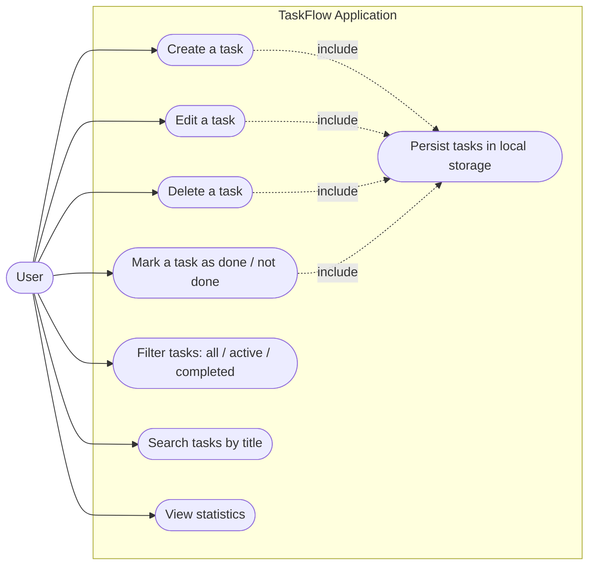
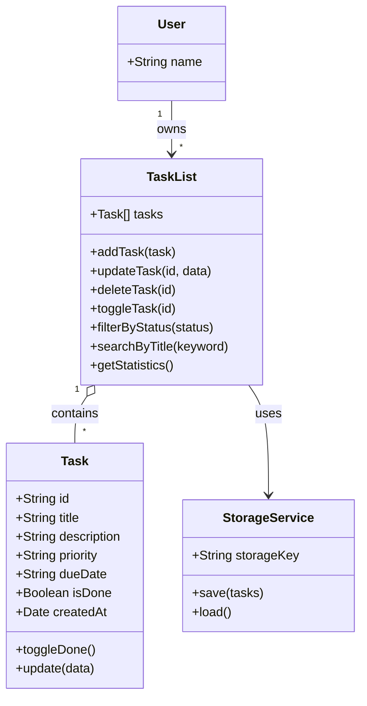

# Design Your Application — TaskFlow

**TaskFlow** is a personal task-management web application that helps students,
freelancers and busy professionals organise their daily work, prioritise what
matters and meet their deadlines.

This document contains the three deliverables required by the checkpoint:

1. The **user story** (needs of the application)
2. The **use case diagram**
3. The **class diagram**

---

## 1. User Story

### Main user story

> **As a** busy student and freelancer,
> **I want** to create, organise and prioritise my tasks in one place,
> **so that** I can focus on the most important work and never miss a deadline.

### Detailed user stories

| # | User story | Acceptance criteria |
|---|------------|---------------------|
| US-1 | As a user, I want to **create a task** with a title, description, priority and due date so that I can plan my work. | The task is saved, appears in the list and survives a page reload. |
| US-2 | As a user, I want to **edit a task** so that I can keep its information up to date. | The modified title, description, priority or due date is saved and displayed immediately. |
| US-3 | As a user, I want to **delete a task** so that my list stays clean. | The task disappears from the list and from local storage. |
| US-4 | As a user, I want to **mark a task as done** so that I can track my progress. | The task is visually struck through and counted as completed in the statistics. |
| US-5 | As a user, I want to **filter tasks** (all / active / completed) so that I can focus on what remains to be done. | Only the tasks matching the selected filter are displayed. |
| US-6 | As a user, I want to **search tasks by title** so that I can find a task quickly. | The list updates as I type in the search field. |
| US-7 | As a user, I want to **see statistics** (total, active, completed) so that I can measure my productivity. | The counters update automatically after every action. |

### Actors

- **User** — the only human actor of the application.
- **Local Storage** — a secondary actor (system) used to persist the tasks in
  the browser.

---

## 2. Use Case Diagram

### Use case descriptions

| Use case | Main flow |
|----------|-----------|
| **Create a task** | The user opens the form, enters a title (required), an optional description, a priority and a due date, then validates. The task is added to the list and saved. |
| **Edit a task** | The user selects a task, modifies its fields and saves. The list is refreshed with the new values. |
| **Delete a task** | The user clicks the delete button and confirms. The task is removed from the list and from local storage. |
| **Mark a task as done** | The user toggles the checkbox. The status `isDone` is inverted and the task styling and counters are updated. |
| **Filter tasks** | The user clicks "All", "Active" or "Completed". Only the matching tasks are rendered. |
| **Search tasks** | The user types a keyword. The list is filtered on the task title. |
| **View statistics** | The application displays the number of total, active and completed tasks. |

---

## 3. Class Diagram

### Class responsibilities

- **Task** — represents a single task and holds its data (`id`, `title`,
  `description`, `priority`, `dueDate`, `isDone`, `createdAt`) as well as the
  behaviour that modifies it (`toggleDone`, `update`).
- **TaskList** — manages the collection of tasks: adding, updating, deleting,
  toggling, filtering, searching and computing statistics.
- **StorageService** — persists the task list in the browser's local storage
  so the data is not lost when the page is reloaded.
- **User** — represents the person who owns a task list.

---

## 4. Consistency with the next checkpoints

The next checkpoints of the course are:

- **Develop your own application** → the TaskFlow application is implemented
  in the `taskflow-app` repository, following exactly this design.
- **Deploy your own application** → the same application is deployed online
  and its public URL is provided.

---

## 5. Technology stack

| Layer | Technology |
|-------|------------|
| UI | React 18 (Vite) |
| State | React hooks (`useState`, `useEffect`, `useMemo`) |
| Persistence | Browser `localStorage` |
| Styling | Custom CSS |
| Deployment | GitHub Pages |
