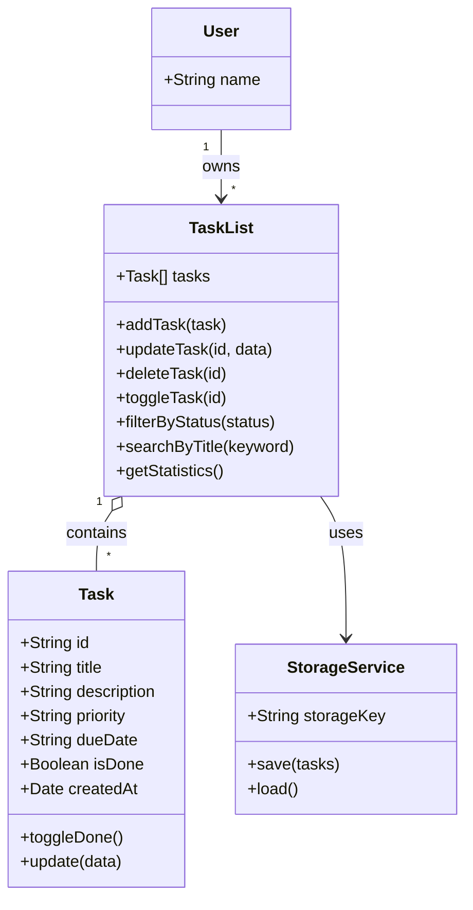

# Class Diagram — TaskFlow

## Description

| Class | Responsibility |
|-------|----------------|
| **Task** | Holds the data of one task: `id`, `title`, `description`, `priority`, `dueDate`, `isDone`, `createdAt`. Exposes `toggleDone()` and `update(data)`. |
| **TaskList** | Manages the collection of tasks: add, update, delete, toggle, filter, search and statistics. |
| **StorageService** | Saves and loads the task list from the browser's local storage. |
| **User** | Represents the owner of a task list. |

## Relationships

- A **User** owns one or many **TaskList** objects (`1 --> *`).
- A **TaskList** is composed of zero or many **Task** objects (`1 o-- *`).
- A **TaskList** uses a **StorageService** to persist its data.
