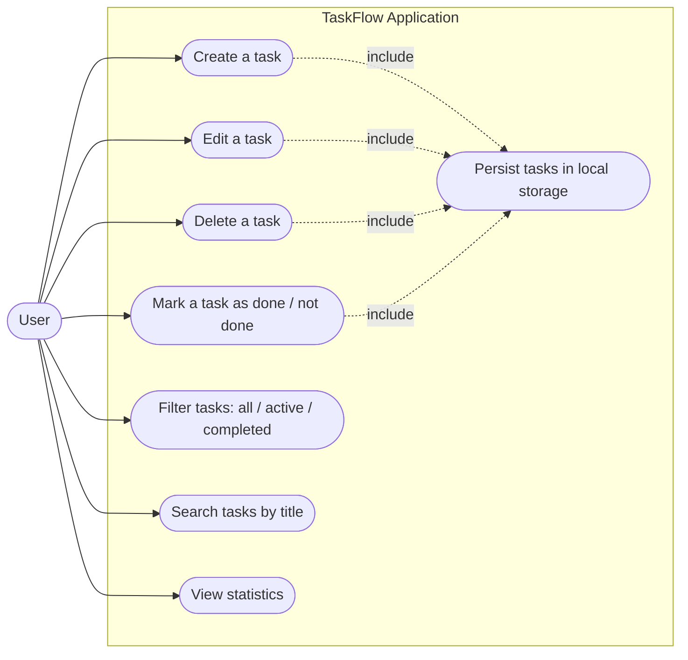

# Use Case Diagram — TaskFlow

## Actors

| Actor | Description |
|-------|-------------|
| **User** | The person who manages his or her tasks. |
| **Local Storage** | System actor that persists the tasks in the browser. |

## Use cases

| Use case | Description |
|----------|-------------|
| Create a task | Add a new task with a title, description, priority and due date. |
| Edit a task | Modify the information of an existing task. |
| Delete a task | Remove a task permanently. |
| Mark a task as done | Toggle the completion status of a task. |
| Filter tasks | Display all, active or completed tasks. |
| Search tasks | Find a task by its title. |
| View statistics | Display total, active and completed counters. |
| Persist tasks | Save and load the task list from local storage. |
